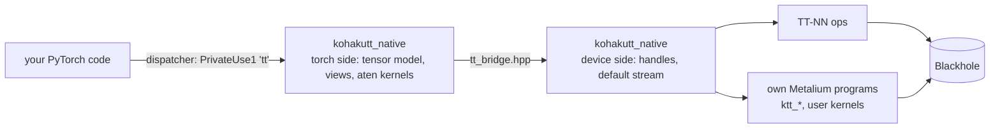
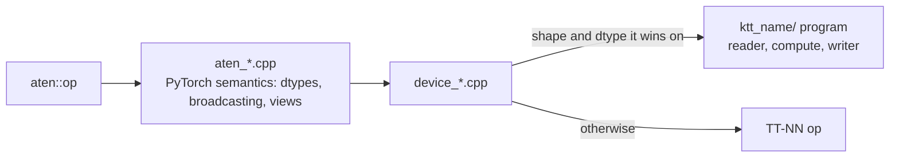
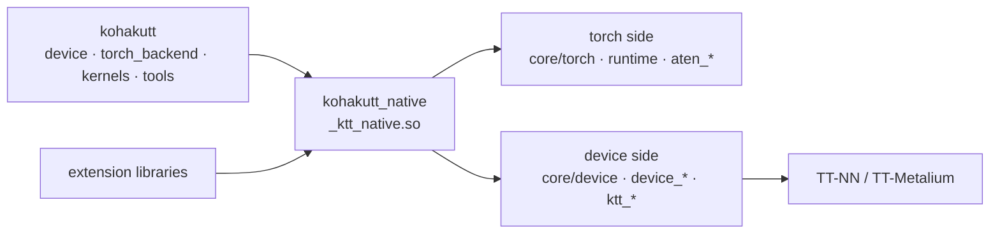

# Kohaku-TT

A native PyTorch device for Tenstorrent Blackhole: `tt` is a `torch.device` like `cuda`,
and ordinary PyTorch code runs on the card through TT-NN and TT-Metalium. Eager ops
queue on an asynchronous stream, autograd and optimizers train on the device,
`torch.compile` replays captured device traces, weights can live in TT's block-float
formats, and your own Metalium kernels become torch ops on tt tensors.

TT-NN is a library of device ops with its own tensor type; tt-xla reaches the card from
PyTorch by compiling whole graphs through XLA. Kohaku-TT puts the card under PyTorch's
dispatcher instead: every aten op a model calls is a tt kernel, a composite of tt
kernels or Kohaku-TT's own Metalium program, so a model, its training loop and its tools
move to the card with `.to(dev)` and keep running op by op, as on CUDA.

```python
import torch
import kohakutt

dev = kohakutt.device(0)  # chip 0 as a torch.device ("tt:0")
model = MyModel().bfloat16().to(dev)
opt = torch.optim.AdamW(model.parameters())

loss = loss_fn(model(x.to(dev)), y.to(dev))  # plain PyTorch from here on
loss.backward()
opt.step()

fast = torch.compile(model, backend="ktt_tt_aot")  # "ktt_tt" for inference
```

**Status: early development.** Eager execution, training and `torch.compile` run end to
end on real models (ViT, Qwen2.5 training, the MOSS-Image text-to-image pipeline);
performance work is ongoing ([measured](#measured), [limitations](#limitations)).

**Contents:** [Highlights](#highlights) · [Install](#install) · [Quick
start](#quick-start) · [How it works](#how-it-works) · [Custom kernels](#custom-kernels)
· [Knobs](#knobs) · [Measured](#measured) · [Limitations](#limitations) · [Repository
layout](#repository-layout) · [Documentation](#documentation) · [Checks](#checks)

## Highlights

- **Faster than tt-xla on the same card, eager or compiled.** ViT-B/16 at batch 1: 77
  images/s eager and 114 compiled against tt-xla's 8; a ViT-B/16 training step at batch
  8: 244 ms against 100.9 s; Qwen2.5-0.5B prefill of 128 tokens: 129 ms eager and 45 ms
  compiled against 207 ms ([measured](#measured)).
- **Every Core ATen op runs on tt.** 193 of 193 Core ATen overloads have a tt kernel or
  a composite of tt kernels; across all of aten, 559 kernels and 2026 composites of 3120
  overloads ([support table](docs/reference/aten_support.md)). An op without one raises
  `KohakuTTUnsupportedOperator` naming the overload; the CPU runs it only when asked.
- **A real device, not a tensor wrapper.** Storage-backed tensors with PyTorch's views
  and aliasing (in-place writes through views, version counters), `torch.tt` for
  `synchronize`, memory statistics and RNG state, `torch.save` / `load`, `state_dict`,
  printing, `module.to("tt")` with buffers.
- **Kernels where TT-NN falls short.** Kohaku-TT's own Metalium programs replace TT-NN's
  where they measure faster or where TT-NN is wrong:
  - flash attention (`ktt_flash`, default): single-pass online softmax with fp32 row
    statistics, masks, causal, MHA / GQA / MQA; 2.4-7.2x TT-NN's SDPA at the same precision
    with the accurate exponential, about equal with the approximate one
    ([reference](docs/reference/kernels/flash.md));
  - layer norm / RMS norm (`ktt_norm`, default) with fp32 statistics, forward and backward,
    where TT-NN's bf16-statistics kernels give wrong training results
    ([reference](docs/reference/kernels/layernorm.md));
  - grouped, depthwise and strided conv with gradients (`ktt_conv2`), and a channels-last
    dense conv (`ktt_conv_nhwc`, forward and input gradient, opt-in), 1.1-1.4x TT-NN's
    conv2d on VAE / SD / ResNet layers, slower at 1280 channels for now
    ([reference](docs/reference/kernels/conv-nhwc.md));
  - blocked unary SFPU chains (up to 1.7x TT-NN's eltwise at mid sizes), broadcast
    binaries that read the broadcast tile once (1.1-1.17x), per-shape 2-D multicast matmul
    configs (140-161 TFLOPS on the MOSS DiT's projections).
- **Faster and more accurate than TT-NN on real models.** ConvNeXt-tiny: forward 26x and a
  training step 7.1x faster than the same model on TT-NN's kernels, with gradients as
  close to float64 as CPU bf16's; DINOv3 ViT-B: forward 1.27x faster with lower error
  ([measured](#measured)).
- **Your kernels as torch ops.** A reader / compute / writer Metalium program described
  in Python or built in C++ becomes `torch.ops.<ns>.<op>` on tt tensors, in order with
  every other op; a SwiGLU written this way runs in 0.132 ms against 0.283 ms for
  `F.silu(a) * b` at 1024 x 4096 ([custom kernels](#custom-kernels)).
- **Block-float weights, as stored.** `kohakutt.block_float_linears(model, "bfp8")`
  keeps every linear weight in BFLOAT8_B (or BFLOAT4_B), stored as its (in, out)
  transpose; `F.linear` multiplies them with bf16 activations and fp32 accumulation
  through TT-NN's minimal matmul (1.4-1.6x `ttnn.linear` at the MOSS DiT's
  projections), without a dequantized copy.
- **Fused transformer ops.** `torch.ops.ktt.rms_norm(x, weight, bias, eps)` (affine
  RMSNorm, e.g. a modulated norm) and `torch.ops.ktt.rotary(x, cos, sin)` (rotate-half
  RoPE) run one program each on tt, fp32 math on bf16 tensors; elsewhere their fp32
  composites.
- **Precision as a scope.** `kohakutt.numerics(fidelity=, approx=)` sets the math of
  every op queued under it, per thread, per module (`numerics_for`) or per function;
  HiFi2 by default, with floors where kernels need precision or get it for free.
- **Numerics you can check.** `KernelAudit` runs every aten call of a block against a
  CPU float64 ruler and a same-precision CPU simulation and reports the error statistics
  of both, per call, per module and per model.

## Install

- A Tenstorrent Blackhole card (developed on P150A) with its kernel driver and firmware.
- A tt-metal source build: TT-NN and TT-Metalium, with the `tt-train` sources.
- Python 3.13, CMake 3.24+, Ninja, clang++-20; PyTorch 2.15 (the CPU wheel: the card is
  added as a PyTorch device).

From a clone:

```
uv venv -p 3.13
uv pip install --index-url https://download.pytorch.org/whl/cpu torch==2.15.0+cpu
uv pip install -e ".[dev]"

export TT_METAL_HOME=/path/to/tt-metal TT_METAL_RUNTIME_ROOT=/path/to/tt-metal
CXX=clang++-20 cmake -S src/kohakutt_native -B build/native -G Ninja \
    -DPython_EXECUTABLE=$PWD/.venv/bin/python
ninja -C build/native                     # src/kohakutt_native/_ktt_native.so
ktt doctor
```

The native layer builds against the tt-metal tree it is pointed at: CMake reads TT-NN's
include directories and defines from that tree's own build, so the two always match.
`ktt doctor` is a read-only report of the host and every card on it: identity, firmware,
PCIe link against the expected one, clocks, power and temperature, with a warning per
problem.

| Extra | Adds |
|---|---|
| `dev` | pytest, ruff, black, blacken-docs, clang-format |

## Quick start

**One chip.** `kohakutt.device(i)` opens chip *i* on first use and returns its
`torch.device`; everything after `.to(dev)` is ordinary PyTorch:

```python
dev = kohakutt.device(0)
x = torch.randn(4096, 4096, dtype=torch.bfloat16).to(dev)
y = (x @ x.T).softmax(-1)  # queued; returns at once
kohakutt.synchronize(dev)  # waits for the queued work
print(y[0, :4])  # a host read waits too
```

**Two chips as one device.** `kohakutt.mesh([0, 1])` is a 1 x 2 mesh with every tensor
replicated on both chips. To use two chips for two jobs instead, run one process per
chip with `TT_VISIBLE_DEVICES`:

```
TT_VISIBLE_DEVICES=0 python generate.py --shard 0/2 &
TT_VISIBLE_DEVICES=1 python generate.py --shard 1/2 &
```

**Compile or capture a repeated step.** Both replay the step as one device trace:

```python
compiled = torch.compile(model, backend="ktt_tt")  # inference; "ktt_tt_aot" trains
step = kohakutt.capture(train_step, x, y)  # capture once, replay on every call
```

**Block-float weights.**

```python
kohakutt.block_float_linears(model, "bfp8")  # every nn.Linear weight, in place
y = model(x)  # bf16 activations x bfp8 weights
```

**A whole model.** [examples/06_moss_image](examples/06_moss_image/) runs MOSS-Image (a
Qwen3.5 text encoder, a DiT flow sampler with CFG, the FLUX.2 VAE) as plain PyTorch
modules on tt, at the size each prompt asks for:

```
python examples/06_moss_image/generate.py --model MOSS-Image-Base \
    --width 1344 --height 768
python examples/06_moss_image/generate.py --model MOSS-Image-Base --prompts prompts/ \
    --cfgs 2 3 4.5 --seeds 0 1 --out-dir images/
```

| Command | Does |
|---|---|
| `ktt doctor` | read-only report of the host and every card: firmware, link, telemetry |
| `python -m kohakutt.tools.support` | regenerates the aten support table from the registered kernels |
| `python -m kohakutt.bench.ops [--ops ...] [--json ...]` | per-op cold / warm time, error statistics against float64 next to the CPU same-dtype result, batch rows against each row alone |
| `python -m kohakutt.tools.cxx_format [--check]` | formats the C / C++ sources |

## How it works



| Layer | Package | Holds |
|---|---|---|
| Python | `kohakutt` | the device and mesh API, torch registration and `torch.tt`, trace capture and the `torch.compile` backends, block floats, `kohakutt.kernels`, tools, benchmarks |
| Torch side | `kohakutt_native`: `csrc/core/torch`, `csrc/runtime`, `csrc/aten/*/aten_*.cpp` | the tt tensor model (storage, strides, views), the aten registrations with PyTorch's semantics, capture, the device guard |
| Device side | `kohakutt_native`: `csrc/core/device`, `csrc/aten/*/device_*.cpp`, `ktt_*/` | device handles, the default stream, TT-NN calls, Kohaku-TT's own Metalium programs |

The two sides of the native layer never include each other's headers: torch and TT-NN
each bundle their own fmt and other dependencies, so they meet only in
`csrc/core/device/tt_bridge.hpp`, an interface of plain types and opaque handles.

### Tensors

A tt tensor is a PyTorch storage holding a device handle plus sizes, strides and an
offset, so views are metadata: `view`, `reshape`, `transpose`, `permute`, `expand`,
`slice`, `select`, `unsqueeze` and the rest alias the storage, and an in-place write
through a view lands in the base. An op that needs a dense input materializes the view
on the device (a TT-NN slice, permute or copy); a matmul absorbs transposes, and
attention reads split heads in place. Device tensors are TILE layout (32 x 32 tiles);
0-d and 1-D tensors are stored as one tile row.

### The default stream

Every op returns as soon as it is queued. A worker thread owns the device and runs the
queue in issue order, so the host thread races ahead of the card as with CUDA streams. A
host read (`.cpu()`, `.item()`, printing), `synchronize()` and data-dependent ops wait
for the queue. An op that fails on the worker marks the stream: queued work behind it is
skipped, and the first error is raised at the next call into the device.

### Ops



Each op family (`eltwise`, `linalg`, `attention`, `nn`, `reduce`, `index`, `tensor`,
`spectral`) is one folder of `csrc/aten/`: `aten_*.cpp` registers the overloads and
handles PyTorch's semantics, `device_*.cpp` implements them on the device, and a
`ktt_<name>/` folder holds a Metalium program of Kohaku-TT's own. An own program is used
for the shapes and dtypes where it measured faster than TT-NN, and
`KTT_CUSTOM_KERNELS=0` turns every one off for an A/B run.

### Precision

Every op is queued with the calling thread's numerics scope: `fidelity`, the passes of
the FPU's multiplies (`LoFi` < `HiFi2` < `HiFi3` < `HiFi4`); `approx`, the SFPU's
approximations of exp, reciprocal, sqrt and the like; and `attention`, how attention
prepares Q and K (`exact`; `centered`, K minus its sequence mean, which softmax ignores;
`centered_bfp8`, then Q and K as bfp8). The default is HiFi2, exact.
Accumulation is always fp32, and fp32 inputs unpack to fp32 registers.

```python
with kohakutt.numerics(fidelity="LoFi", approx=True):
    y = model(x)  # every op queued in the scope

kohakutt.numerics_for(model.attn, fidelity="HiFi3")  # one module, in every call


@kohakutt.numerics(fidelity="LoFi")
def step(x): ...
```

A scope is read when an op is queued, so it holds for asynchronous work, and a captured
trace or compiled graph keeps the scope it was captured under (`torch.compile` captures
one trace per scope). Kernels bound the scope with requirements: reductions, softmax and
norms are memory-bound, so they run at least HiFi4 at no measurable cost, and the
broadcast binary kernel stays exact (division). `strict=True` ignores the requirements,
for A/B runs. `KTT_FIDELITY` and `KTT_APPROX=1` set the process default.

Numerics are reported as statistics against a float64 ruler and a same-precision CPU
simulation, never as a pass / fail threshold ([numerics](docs/concepts/numerics.md)).

### Trace and compile

`kohakutt.capture(fn, *inputs)` runs `fn` once to warm up, captures the next run as a
TT-NN trace and replays it on every later call; outputs are held device tensors copied
out after each replay, and in-place effects (optimizer state, running statistics, input
mutation) write the live tensors. The `ktt_tt` and `ktt_tt_aot` backends lower dynamo
graphs (forward and backward for `ktt_tt_aot`) to tt ops and run them as captured traces
([trace contract](docs/concepts/trace.md)).

### Multiple cards

`kohakutt.mesh([0, 1])` opens two chips as one torch device. A tensor of 1 MiB or more
is sharded over the chips when it is created; smaller ones are replicated. Each op runs
the single-card kernel on each chip's shard, and a small rule engine inserts the TT-NN
collective (all-gather, reduce-scatter, all-reduce, all-to-all, partition) where an op
needs another placement. Linear pairs are placed column → row by default (up / gate /
q / k / v projections split on their outputs, down / out projections on their inputs),
so a transformer MLP or attention block costs one reduce-scatter.

```python
class Block(nn.Module):
    def __init__(self, d):
        super().__init__()
        self.norm = kohakutt.replicate(nn.LayerNorm(d))  # a copy on each chip
        self.up = kohakutt.colwise(nn.Linear(d, 4 * d))  # output features split
        self.down = kohakutt.rowwise(nn.Linear(4 * d, d))  # input features split

    def forward(self, x):
        return x + self.down(nn.functional.gelu(self.up(self.norm(x))))


dev = kohakutt.mesh([0, 1])
model = nn.Sequential(Block(2048), Block(2048)).bfloat16().to(dev)  # marks applied
x = torch.randn(4096, 2048, dtype=torch.bfloat16).to(dev)
y = model(x)
kohakutt.placement(model[0].down.weight)  # "Sharded(dim=1)"
torch.tt.mesh_stats()  # collectives so far
```

Marks return the same module, so the model stays a plain `nn.Module` and
`torch.compile` and `kohakutt.capture` see it unchanged; on one chip every mark is a
no-op. `kohakutt.place(module, weight="S(1)", bias="R")` marks any module's tensors,
and `kohakutt.shard(t, dim)` / `kohakutt.replicate(t)` convert a tensor on the spot
([mesh design](docs/concepts/mesh.md)).

## Custom kernels

A Metalium program (a reader, a compute and a writer kernel, with their circular buffers
and arguments) becomes a torch op on tt tensors, from Python or from C++. It runs on the
default stream in order with every other op, and on a mesh on every chip.

**From Python** ([examples/custom_kernel](examples/custom_kernel/)):

```python
import kohakutt.kernels as kk


@kk.op("myns::swiglu(Tensor a, Tensor b) -> Tensor")
def swiglu(a, b):
    out = kk.empty_like(a)
    split = kk.split_tiles(a)
    return kk.Program(
        cbs=[kk.CB(0, a), kk.CB(1, b), kk.CB(16, out)],
        reader=kk.Kernel("kernels/reader.cpp", [a, b], lambda c: [a, b, *split[c]]),
        compute=kk.Kernel(
            "kernels/compute.cpp", runtime_args=lambda c: [split[c][1]], fp32_dest=True
        ),
        writer=kk.Kernel("kernels/writer.cpp", [out], lambda c: [out, *split[c]]),
        outputs=[out],
        cores=split,
    )


y = torch.ops.myns.swiglu(a_tt, b_tt)
```

A tensor in a kernel's compile-time arguments becomes its `TensorAccessorArgs`, in its
runtime arguments its buffer address. The description is built once per argument sizes
and dtypes; later calls only patch buffer addresses.

**From C++** ([examples/custom_kernel_cpp](examples/custom_kernel_cpp/)): the program
builder includes `ktt/extension/device.hpp` (TT-NN side), the op includes
`ktt/extension/torch.hpp` (torch side), and `kohakutt_add_extension()` from the
installed package's CMake module builds the library:

```cpp
// device side
// tensors: the inputs, then the outputs; numerics: the caller's scope
ProgramDescriptor swiglu(
    const std::vector<ttnn::Tensor>& tensors, const ktt::extension::Numerics& numerics
);
KTT_REGISTER_PROGRAM("myns::swiglu", swiglu);

// torch side
at::Tensor swiglu_op(const at::Tensor& a, const at::Tensor& b) {
    return ktt::extension::run(
        "myns::swiglu", {a, b}, {{a.sizes().vec(), a.scalar_type()}}
    )[0];
}
```

```python
import kohakutt.extension

kohakutt.extension.load("build/swiglu_ext/swiglu_ext.so")
y = torch.ops.myns.swiglu(a_tt, b_tt)
```

| API | Does |
|---|---|
| `kk.op(schema)` | registers a Python program builder as a torch op on tt tensors |
| `kk.Program`, `kk.CB`, `kk.Kernel` | circular buffers, the three kernels with their arguments and compute options, the outputs |
| `kk.empty`, `kk.empty_like`, `kk.split_tiles`, `kk.tile_count` | outputs; the tiles of a tensor split over the grid |
| `ktt::extension::register_program`, `KTT_REGISTER_PROGRAM` | a C++ builder `ProgramDescriptor(const std::vector<ttnn::Tensor>&, const Numerics&)` with optional `Requirements` |
| `ktt::extension::run` | runs a registered program over tt tensors from a C++ op |
| `kohakutt.extension.load`, `cmake_module`, `include_dir` | loads an extension library; paths for its build |

## Knobs

| Variable | Default | |
|---|---|---|
| `KTT_FIDELITY` | `HiFi2` | default fidelity of the FPU's multiplies: `LoFi`, `HiFi2`, `HiFi3`, `HiFi4` (`kohakutt.numerics` scopes override it; `KTT_MATMUL_FIDELITY` is an alias) |
| `KTT_APPROX` | 0 | 1 turns SFPU approximations on by default |
| `KTT_L1_BUDGET` | 0.4 (0 on a mesh) | the fraction of each core's L1 that activations may fill (L1 interleaved); 0 keeps them in DRAM (see [limitations](#limitations)) |
| `KTT_MATMUL_EXPLICIT` | 1 | 0 uses TT-NN's default matmul program configs instead of Kohaku-TT's per-shape 2-D multicast configs |
| `KTT_NATIVE_CONV` | 1 | 0 runs bf16 2-D convs as per-tap matmuls instead of TT-NN's conv2d |
| `KTT_OWN_CONV` | 1 | 0 runs stride-1 single-group convs (C a multiple of 32) on TT-NN's conv2d instead of Kohaku-TT's implicit-GEMM conv |
| `KTT_CONV_WINDOW` | 1 | 0 reads each convolution tap's input rows separately instead of one window per kernel row |
| `KTT_CONV_LAYOUT` | 1 | 0 runs TT-NN's permute / pad / tilize around Kohaku-TT's conv instead of its own layout kernels (sizes as runtime arguments) |
| `KTT_OWN_GROUP_NORM` | 1 | 0 runs bf16 group norm as the composite of reductions and binaries instead of Kohaku-TT's moments / affine kernels (sizes as runtime arguments) |
| `KTT_OWN_UPSAMPLE` | 1 | 0 runs nearest upsampling (integer factors dividing 32) and pixel shuffle as interpolation matmuls instead of Kohaku-TT's gather kernels |
| `KTT_OWN_ATTENTION` | 1 | unmasked causal and grouped-head bf16 attention run Kohaku-TT's flash attention; `all` also plain non-causal attention, 0 none (TT-NN's SDPA) |
| `KTT_ATTENTION_FP32` | 1 | 0 runs Kohaku-TT's attention with bf16 DST and intermediates (faster; the running sums lose precision at long sequences) |
| `KTT_SDPA_FP32_DEST` | 0 | 1 runs TT-NN's unmasked attention with fp32 dest registers (lower noise; reads a ragged last key tile's padding as keys) |
| `KTT_L1_SMALL` | 98304 | bytes per core reserved for TT-NN's small L1 buffers (conv metadata) |
| `KTT_OWN_MATMUL` | 1 | 0 sends every bf16 matmul to TT-NN's matmul; 1 runs Kohaku-TT's matmul (every size a runtime argument) where it is faster warm: K, N up to 1024, M from 16384 rows and an output of 12.5M to 30M elements |
| `KTT_OWN_MATMUL_MIN_ROWS` | unset | set: Kohaku-TT's matmul for every bf16 matmul with K, N up to 1024 and at least this many rows (first call at a new M about 0.5 ms instead of TT-NN's 30-1570 ms) |
| `KTT_TREE_PROD` | 1 | 0 sends `prod` to TT-NN's prod (rounds fp32 to bf16) instead of fp32 elementwise multiplies of halves |
| `KTT_MINIMAL_MATMUL` | 1 | 0 sends `[K, N]`-stored weights and plain bf16 `a @ b` to `ttnn.matmul` instead of TT-NN's minimal matmul |
| `KTT_CUSTOM_KERNELS` | 1 | 0 runs TT-NN's implementation for every op that has an own program |
| `KTT_FLASH` | 1 | 0 runs bf16 attention on the previous routes instead of `ktt_flash` |
| `KTT_NHWC` | 0 | 1 keeps activations channels-last between the ops that read it; single-group "same" stride-1 convs then run `ktt_conv_nhwc` |
| `KTT_GEMM` | 0 | 1 runs bf16 / block-float `mm` and `linear` on Kohaku-TT's `ktt_gemm` instead of TT-NN's matmul |
| `KTT_DESC_CACHE` | 1 | 0 builds the program descriptor of every own program on each call, instead of reusing one per program, sizes and memory placement with only the buffer addresses rewritten (user programs stay cached); `verify` reuses and also rebuilds, raising when the two differ |
| `KTT_PHILOX` | 0 | 1 draws `rand` / `randn` (and the distributions built on them) from Philox4x32-10 at each element's global index, so a mesh-sharded draw equals the 1-card draw bit for bit; about 100x slower than TT-NN's per-core generators (`torch.ops.ktt.philox_uniform` draws it directly) |
| `KTT_CPU_FALLBACK` | 0 | 1 runs ops without a tt kernel on the CPU instead of raising, with a warning and a per-op count (`kohakutt.fallback_counts()`) |
| `KTT_FALLBACK_WARN` | 1 | 0 silences the fallback warning; counts are still kept |
| `KTT_MESH_AUTO` | 1 | 0 creates every tensor on a mesh replicated |
| `KTT_MESH_SHARD_MIN` | 1048576 | bytes from which a new tensor (and a Linear in the default pairing) is sharded |
| `KTT_MESH_AUTO_PAIRS` | 1 | 0 leaves unmarked Linears at the size-based placement instead of the column → row pairing |
| `KTT_MESH_STRICT` | 0 | 1 raises when an op has no placement rule instead of gathering its inputs (`torch.tt.mesh_fallback_ops()` lists them) |
| `KTT_MESH_MIGRATE` | 0 | 1 moves persistent tensors to the placement their consumers ask for |
| `KTT_MESH_ALL_TO_ALL` | 1 | 0 converts S(i) → S(j) by all-gather and partition instead of one all-to-all |
| `KTT_MESH_CCL` | 1 | 0 converts placements through the host instead of TT-NN collectives |
| `KTT_FABRIC` | 1 | 0 opens a mesh without the fabric (no collectives) |
| `TT_VISIBLE_DEVICES` | every chip | chips this process may open (TT-Metal) |

| Tool | Does |
|---|---|
| `kohakutt.tools.kernel_audit.KernelAudit` | every aten call of a block against a float64 ruler and a same-precision CPU simulation (error statistics of both), or each call's device-synchronized time |
| `kohakutt.tools.profile.OpProfile` | time, programs and host transfers per aten overload of a block |
| `kohakutt.diff_stats(result, reference)` / `kohakutt.format_stats(stats)` | max / median / mean of the absolute and relative error (rel over nonzero reference positions), cosine similarity and non-finite count, compared in float64; `format_stats` prints them on one line |

## Measured

One Blackhole P150A, bf16 unless named. Kohaku-TT eager and compiled against the same
PyTorch workloads on tt-xla (torch-xla with the TT PJRT plugin), one stack per process,
median ms per step after warm-up (`src/kohakutt/bench/perf/xla_compare.py`,
`workloads.py`):

| Workload | Kohaku-TT eager | Kohaku-TT compiled | tt-xla |
|---|---|---|---|
| ViT-B/16 inference, batch 1 | 77 img/s | 114 img/s | 8 img/s |
| ViT-B/16 inference, batch 8-64 | 181-189 img/s | 181-188 img/s | up to 97 img/s |
| ViT-B/16 training step, batch 8 | 244 ms | | 100.9 s |
| Qwen2.5-0.5B prefill, 128 tokens | 129 ms | 45 ms | 207 ms |
| Qwen2.5-0.5B prefill, 512 tokens | 142 ms | 106 ms | 199 ms |

**MOSS-Image** (`examples/06_moss_image`: bfp8 DiT weights, bf16 activations with fp32
math inside each fused op, HiFi2, eager, one chip). One DiT forward at 1360 x 768 with
1615 text tokens (5695 tokens) takes 0.652 s. A CFG step is the cond and the uncond
forward:

| Image | Text tokens (cond / uncond) | CFG step |
|---|---|---|
| 1024 x 1024 | 300 / 8 | 0.935 s |
| 1360 x 768 | 1615 / 8 | 1.104 s |
| 1024 x 1024 | 1615 / 8 | 1.129 s |

The VAE decodes a 1312 x 800 image in 1.1 s; the first decode at a new size takes about
a minute (host setup in TT-NN ops, see [TT-NN known issues](docs/reference/ttnn-known-issues.md)).
Details and per-op numbers: [performance](docs/concepts/performance.md).

**Kernels** (device-synchronized time per call over 20 async calls):

| Kernel | Kohaku-TT | Reference |
|---|---|---|
| DiT projections at M = 4115, explicit 2-D multicast configs | 140-161 TFLOPS | |
| SwiGLU as a user program, 1024 x 4096 bf16 | 0.132 ms | `F.silu(a) * b`: 0.283 ms |
| SwiGLU as a user program, 4096 x 4096 bf16 | 0.238 ms | `F.silu(a) * b`: 0.429 ms |

**Own kernels against TT-NN** (per call, same precision settings for both, HiFi2):

| Op | Shape | Kohaku-TT | TT-NN |
|---|---|---|---|
| SDPA (`ktt_flash`) | 1x32x4096x64 | 2694 µs | 7756 µs |
| SDPA, causal | 1x8x1024x64 | 65 µs | 465 µs |
| SDPA, additive mask | 1x16x2048x64 | 537 µs | 1677 µs |
| conv 3x3 (`ktt_conv_nhwc`) | VAE 1x512x64x64 | 150.9 µs | 215.8 µs |
| conv 3x3 | SD1.5 2x320x64x64 | 164.3 µs | 216.5 µs |
| conv 3x3 | ResNet 1x64x56x56 | 41.2 µs | 48.3 µs |

**Real models against the same models on TT-NN's kernels** (`KTT_CUSTOM_KERNELS=0`), bf16,
eager, warm; error is the median relative error against a CPU float64 run (CPU bf16 in
brackets):

| Model | Kohaku-TT | TT-NN kernels | Error, Kohaku-TT / TT-NN |
|---|---|---|---|
| DINOv3 ConvNeXt-tiny, forward 224 px | 14.1 ms | 365.8 ms | 4.1e-2 / 8.3e-2 (3.4e-2) |
| DINOv3 ConvNeXt-tiny, training step | 199.8 ms | 1427.9 ms | gradients 0.067 / 0.127 (0.061) |
| DINOv3 ViT-B/16, forward 224 px | 35.6 ms | 45.3 ms | 2.7e-2 / 3.5e-2 (2.0e-2) |
| DINOv3 ViT-B/16, training step | 103.2 ms | 112.2 ms | loss 0.007 / 0.019 (0.011) |

TT-NN spends roughly 35-65 µs of host time per program, so models made of many small
ops are bound by program count rather than by the card; Kohaku-TT's fused ops and
pointwise chains (`torch.ops.ktt.rms_norm`, `ktt.rotary`, `kohakutt.fusion`) collapse
such chains into one program each.

## Limitations

- **One device or mesh per process**, and a mesh replicates tensors: no tensor- or
  data-parallel placement yet.
- **A trace holds every intermediate** of the captured graph, so very large forwards do
  not fit as one trace; run them eagerly.
- **fp32 matmuls** are accurate to about 1e-3 relative (bf16-level operand precision),
  not to CPU fp32.
- **1-D tensors** are one padded tile row, which costs memory for large vectors.
- **bf16 NaN** may come back as inf after device ops (a hardware property; fp32 is
  unaffected).
- **Data movement** (permutes, gathers of arbitrary strided views) runs as TT-NN op
  chains, not yet near memory bandwidth. A view that no TT-NN op expresses (e.g. a 6-D
  permute that moves size-2 dims last) is gathered through a per-element index built on
  the host: correct, but slow and memory-heavy at image sizes. `F.pixel_shuffle` /
  `F.pixel_unshuffle` have their own kernels; prefer them over the reshape + permute
  spelling. Tensors whose last two dims are small (e.g. `[..., 2, 128]` from
  `repeat_interleave` over heads before the sequence dim) pad each trailing matrix to
  32 x 32 tiles: up to 16x the memory (a 5 x 1615-token GDN head repeat asked for 8.4
  GB); repeat or expand after moving the sequence dim next to the last.
- **Attention** without a mask or causal masking runs TT-NN's streaming kernel, with bf16
  (not fp32) dest registers, which masks a ragged last key tile itself; any sequence
  length runs at the unmasked kernel's speed. Causal and masked calls keep fp32 dest. Masks broadcast as
  `[B | 1, H | 1, Sq, Sk]`. The fused kernel takes bf16 q / k / v with equal head
  counts, a head dim that is a multiple of 32 and no dropout; other calls (fp32, grouped
  heads, dropout) run PyTorch's math composite on tt ops.
- **L1-resident activations** (on by default, `KTT_L1_BUDGET`, the fraction of each
  core's L1 they may fill, default 0.4): when a program's circular buffers would not fit
  beside them, every L1 activation moves to DRAM, the program runs again, and the budget
  halves for the rest of the process (models whose kernels take most of L1, such as the
  MOSS DiT's attention and matmuls, settle near all-DRAM). A view and
  its base that share an L1 buffer each get their own DRAM copy then, so an in-place
  write through one is no longer seen through the other. `KTT_L1_BUDGET=0` keeps every
  activation in DRAM and aliasing exact.
- **First call at a new shape** of TT-NN's tiled reshape, padded slice, permute and conv2d
  costs host setup proportional to the tensor (seconds at image sizes; a MOSS VAE
  decode at a new resolution takes about a minute, then about 1 s). Repeat calls at the
  same shapes are warm ([TT-NN known issues](docs/reference/ttnn-known-issues.md)).
- **Selection matmuls** (interpolation, pixel shuffle, `index_copy`) copy values
  exactly, fp32 included, at three products per fp32 operand.

## Repository layout



```
src/kohakutt/                  the package you import
  device/                      device and mesh API
  torch_backend/               registration, torch.tt, fallback, trace capture, compile
  kernels.py, extension.py     user Metalium programs from Python; C++ extension libraries
  block_float.py               block-float weights
  core/  tools/  bench/        numerics, doctor; audit, profiler, formatter; benchmarks
src/kohakutt_native/           the native layer (README inside)
  csrc/aten/<family>/          every aten op: aten_*.cpp, device_*.cpp, ktt_<name>/
  csrc/core/torch/, device/    the tensor model; the device, stream, handles
  csrc/runtime/                device guard, hooks, capture, ktt:: ops, user programs
  include/ktt/extension/       the C++ extension API
  cmake/KohakuTT.cmake         build flags; kohakutt_add_extension()
examples/                      plain-PyTorch examples, MOSS-Image, custom kernels
experiments/                   standalone proofs of concept (README inside)
tests/                         core/ (CPU) and hardware/ (needs a card)
docs/                          concepts and reference (index: docs/README.md)
```

## Documentation

| Where | Read it for |
|---|---|
| [docs index](docs/README.md) | every concept and reference page |
| [examples](examples/README.md) | tensors, training, trace, compile, the mesh, MOSS-Image, custom kernels |
| [hardware](docs/concepts/hardware.md) | the Blackhole card as a kernel author sees it: grid, panels, DRAM columns, NoCs, the Tensix core |
| [kernel design](docs/concepts/kernel-design.md) | how Kohaku-TT's own kernels are designed from the hardware topology |
| [kernels](docs/reference/kernels/README.md) | each own kernel: what it computes, coverage, how it works, measured speed |
| [kohakutt_native](src/kohakutt_native/README.md) | the native layer: where an aten op lives, the two sides, the extension API |
| [csrc/aten](src/kohakutt_native/csrc/aten/README.md) | templates for a new aten op and a `ktt_<name>/` program |
| [kernel contract](docs/concepts/kernel-contract.md) | what an aten kernel receives and returns: views, dtypes, outputs |
| [tensor layout](docs/concepts/layout.md) | storage, tiles, padding, views on the device |
| [trace and compile](docs/concepts/trace.md) | what a captured step may do; the compile backends |
| [mesh](docs/concepts/mesh.md) | several chips as one device: placements, rules, collectives, marks, measured speed |
| [numerics](docs/concepts/numerics.md) | fidelity and approximations, scopes, kernel requirements, how precision is checked |
| [block floats](docs/concepts/block-float.md) | BFLOAT8_B / BFLOAT4_B storage, `F.scaled_mm`, numerics |
| [kernel DSL](docs/concepts/dsl.md) | the design note for a kernel language |
| [performance](docs/concepts/performance.md) | how performance problems are found and fixed; MOSS-Image measurements; what was implemented |
| [aten support](docs/reference/aten_support.md) | every aten overload and its status |
| [TT-NN known issues](docs/reference/ttnn-known-issues.md) | TT-NN behaviour found while running real models, with evidence and workarounds |
## Checks

```
python -m pytest tests                          # CPU tests
KTT_HW=1 python -m pytest tests                 # plus the hardware tests (KTT_TEST_CHIP)
python tests/hardware/golden/make_goldens.py    # regenerate the golden outputs
python -m kohakutt.tools.support                # regenerate the aten support table
python -m kohakutt.tools.cxx_format --check
ruff check . && black --check . && blacken-docs -t py313 -l 88 README.md
```

`tests/core` covers numerics, error statistics, the doctor and the package boundary
without a card. `tests/hardware` runs on one: the device API, the tensor model (random
view chains against CPU, in-place writes through views), fallback and exit paths, the
mesh, attention, FFT and memory paths, Hugging Face models and training against CPU,
`torch.compile`, and golden outputs of the numeric kernels (the same bits as a build
whose numerics were checked as statistics).

## Contributing

Open an issue first for a feature. Conventions: black and ruff at 88 columns; C and C++
through `python -m kohakutt.tools.cxx_format` (clang-format with `.clang-format`, plus
the rules it cannot express); Python blocks in Markdown through blacken-docs; no imports
inside functions; torch and TT-NN headers never in one file; comments that say what the
code does; numerics reported as statistics; every check able to fail on a broken
implementation. Run the checks above before a pull request.

## License

Apache-2.0.
