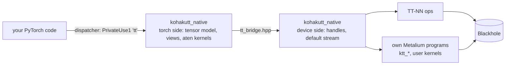
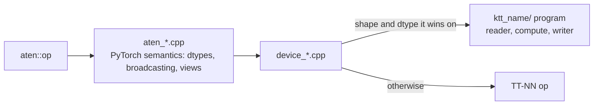

# How Kohaku-TT works

TT-NN is a library of device ops with its own tensor type; tt-xla reaches the card from
PyTorch by compiling whole graphs through XLA. Kohaku-TT puts the card under PyTorch's
dispatcher instead: every aten op a model calls is a tt kernel, a composite of tt
kernels or Kohaku-TT's own Metalium program, so a model, its training loop and its tools
move to the card with `.to(dev)` and keep running op by op, as on CUDA.



| Layer | Package | Holds |
|---|---|---|
| Python | `kohakutt` | the device and mesh API, torch registration and `torch.tt`, trace capture and the `torch.compile` backends, block floats, `kohakutt.kernels`, `kohakutt.dsl` (kernel programs written in Python, compiled once for every shape), tools, benchmarks |
| Torch side | `kohakutt_native`: `csrc/core/torch`, `csrc/runtime`, `csrc/aten/*/aten_*.cpp` | the tt tensor model (storage, strides, views), the aten registrations with PyTorch's semantics, capture, the device guard |
| Device side | `kohakutt_native`: `csrc/core/device`, `csrc/aten/*/device_*.cpp`, `ktt_*/` | device handles, the default stream, TT-NN calls, Kohaku-TT's own Metalium programs |

The two sides of the native layer never include each other's headers: torch and TT-NN
each bundle their own fmt and other dependencies, so they meet only in
`csrc/core/device/tt_bridge.hpp`, an interface of plain types and opaque handles.

## Tensors

A tt tensor is a PyTorch storage holding a device handle plus sizes, strides and an
offset, so views are metadata: `view`, `reshape`, `transpose`, `permute`, `expand`,
`slice`, `select`, `unsqueeze` and the rest alias the storage, and an in-place write
through a view lands in the base. An op that needs a dense input materializes the view
on the device (a TT-NN slice, permute or copy); a matmul absorbs transposes, and
attention reads split heads in place. Device tensors are TILE layout (32 x 32 tiles);
0-d and 1-D tensors are stored as one tile row. Details: [tensor layout](layout.md).

## The default stream

Every op returns as soon as it is queued. A worker thread owns the device and runs the
queue in issue order, so the host thread races ahead of the card as with CUDA streams. A
host read (`.cpu()`, `.item()`, printing), `synchronize()` and data-dependent ops wait
for the queue. An op that fails on the worker marks the stream: queued work behind it is
skipped, and the first error is raised at the next call into the device.

## Ops



Each op family (`eltwise`, `linalg`, `attention`, `nn`, `reduce`, `index`, `tensor`,
`spectral`) is one folder of `csrc/aten/`: `aten_*.cpp` registers the overloads and
handles PyTorch's semantics, `device_*.cpp` implements them on the device, and a
`ktt_<name>/` folder holds a Metalium program of Kohaku-TT's own. An own program is used
for the shapes and dtypes where it measured faster than TT-NN, and
`KTT_CUSTOM_KERNELS=0` turns every one off for an A/B run. An op without a tt kernel or
composite raises `KohakuTTUnsupportedOperator` naming the overload; the CPU runs it only
when asked (`KTT_CPU_FALLBACK=1`).

## Precision

Every op is queued with the calling thread's numerics scope: `fidelity`, the passes of
the FPU's multiplies (`LoFi` < `HiFi2` < `HiFi3` < `HiFi4`); `approx`, the SFPU's
approximations of exp, reciprocal, sqrt and the like; and `attention`, how attention
prepares Q and K (`exact`; `centered`, K minus its sequence mean, which softmax ignores;
`centered_bfp8`, then Q and K as bfp8). The default is HiFi2, exact.
Accumulation is always fp32, and fp32 inputs unpack to fp32 registers.

```python
with kohakutt.numerics(fidelity="LoFi", approx=True):
    y = model(x)  # every op queued in the scope

kohakutt.numerics_for(model.attn, fidelity="HiFi3")  # one module, in every call


@kohakutt.numerics(fidelity="LoFi")
def step(x): ...
```

A scope is read when an op is queued, so it holds for asynchronous work, and a captured
trace or compiled graph keeps the scope it was captured under (`torch.compile` captures
one trace per scope). Kernels bound the scope with requirements: reductions, softmax and
norms are memory-bound, so they run at least HiFi4 at no measurable cost, and the
broadcast binary kernel stays exact (division). `strict=True` ignores the requirements,
for A/B runs. `KTT_FIDELITY` and `KTT_APPROX=1` set the process default.

Numerics are reported as statistics against a float64 ruler and a same-precision CPU
simulation, never as a pass / fail threshold ([numerics](numerics.md)).

## Trace and compile

`kohakutt.capture(fn, *inputs, warmup=3)` runs `fn` `warmup` times eagerly (3 by
default), captures the next run as a TT-NN trace and replays it on every later call; outputs are held device tensors copied
out after each replay, and in-place effects (optimizer state, running statistics, input
mutation) write the live tensors. The `ktt_tt` and `ktt_tt_aot` backends lower dynamo
graphs (forward and backward for `ktt_tt_aot`) to tt ops and run them as captured traces
([trace contract](trace.md)).

## Multiple cards

`kohakutt.mesh([0, 1])` opens two chips as one torch device. A tensor of 1 MiB or more
is sharded over the chips when it is created; smaller ones are replicated. Each op runs
the single-card kernel on each chip's shard, and a small rule engine inserts the TT-NN
collective (all-gather, reduce-scatter, all-reduce, all-to-all, partition) where an op
needs another placement. Linear pairs are placed column → row by default (up / gate /
q / k / v projections split on their outputs, down / out projections on their inputs),
so a transformer MLP or attention block costs one reduce-scatter.

```python
class Block(nn.Module):
    def __init__(self, d):
        super().__init__()
        self.norm = kohakutt.replicate(nn.LayerNorm(d))  # a copy on each chip
        self.up = kohakutt.colwise(nn.Linear(d, 4 * d))  # output features split
        self.down = kohakutt.rowwise(nn.Linear(4 * d, d))  # input features split

    def forward(self, x):
        return x + self.down(nn.functional.gelu(self.up(self.norm(x))))


dev = kohakutt.mesh([0, 1])
model = nn.Sequential(Block(2048), Block(2048)).bfloat16().to(dev)  # marks applied
x = torch.randn(4096, 2048, dtype=torch.bfloat16).to(dev)
y = model(x)
kohakutt.placement(model[0].down.weight)  # "Sharded(dim=1)"
torch.tt.mesh_stats()  # collectives so far
```

Marks return the same module, so the model stays a plain `nn.Module` and
`torch.compile` and `kohakutt.capture` see it unchanged; on one chip every mark is a
no-op. `kohakutt.place(module, weight="S(1)", bias="R")` marks any module's tensors,
and `kohakutt.shard(t, dim)` / `kohakutt.replicate(t)` convert a tensor on the spot.
An op with no placed form for an input gathers it and warns once, and
`with kohakutt.record_placements():` followed by `kohakutt.placement_log()` lists, per
op call, the placements chosen, the conversions made and the reason
([mesh design](mesh.md)).
