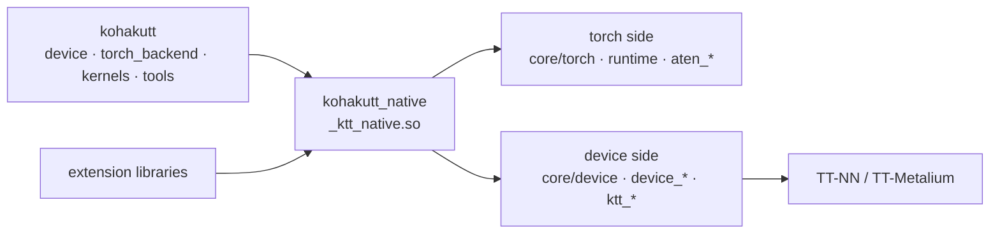

# Development

Building from a clone: [install](install.md#from-a-clone).

## Repository layout



```
src/kohakutt/                  the package you import
  device/                      device and mesh API
  torch_backend/               registration, torch.tt, fallback, trace capture, compile
  kernels.py, extension.py     user Metalium programs from Python; C++ extension libraries
  block_float.py               block-float weights
  core/  tools/  bench/        numerics, doctor; audit, profiler, formatter; benchmarks
src/kohakutt_native/           the native layer (README inside)
  csrc/aten/<family>/          every aten op: aten_*.cpp, device_*.cpp, ktt_<name>/
  csrc/core/torch/, device/    the tensor model; the device, stream, handles
  csrc/runtime/                device guard, hooks, capture, ktt:: ops, user programs
  include/ktt/extension/       the C++ extension API
  cmake/KohakuTT.cmake         build flags; kohakutt_add_extension()
examples/                      plain-PyTorch examples, MOSS-Image, custom kernels
experiments/                   standalone proofs of concept (README inside)
tests/                         core/ (CPU) and hardware/ (needs a card)
docs/                          concepts and reference (index: docs/README.md)
```

How the layers fit together: [how it works](concepts/architecture.md). Where an aten op
lives: [kohakutt_native](../src/kohakutt_native/README.md) and
[csrc/aten](../src/kohakutt_native/csrc/aten/README.md).

## Checks

```
python -m pytest tests                          # CPU tests
KTT_HW=1 python -m pytest tests                 # plus the hardware tests (KTT_TEST_CHIP)
python tests/hardware/golden/make_goldens.py    # regenerate the golden outputs
python -m kohakutt.tools.support                # regenerate the aten support table
python -m kohakutt.tools.cxx_format --check
ruff check . && black --check . && blacken-docs -t py313 -l 88 README.md
```

`tests/core` covers numerics, error statistics, the doctor and the package boundary
without a card. `tests/hardware` runs on one: the device API, the tensor model (random
view chains against CPU, in-place writes through views), fallback and exit paths, the
mesh, attention, FFT and memory paths, Hugging Face models and training against CPU,
`torch.compile`, and golden outputs of the numeric kernels (the same bits as a build
whose numerics were checked as statistics). `KTT_TEST_CHIP` (default 0) is the chip the
single-device hardware tests open.

## Conventions

Open an issue first for a feature. Black and ruff at 88 columns; C and C++ through
`python -m kohakutt.tools.cxx_format` (clang-format with `.clang-format`, plus the rules
it cannot express); Python blocks in Markdown through blacken-docs; no imports inside
functions; torch and TT-NN headers never in one file; comments that say what the code
does; numerics reported as statistics; every check able to fail on a broken
implementation. Run the checks above before a pull request.
